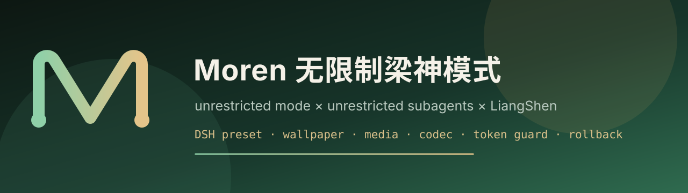

# Moren 无限制梁神模式（dsh-moren-unlimited）



[](https://github.com/MorenLendan/dsh-moren-unlimited/releases)
[](LICENSE)
[](https://github.com/MorenLendan/dsh-moren-unlimited)


把 **DSH purge 的无限制模式**、**无限制子任务** 与 **梁神模式** 合成为一个原生 agent 预设，并带一个左侧栏入口：

- 新建会话时多一个模式：**Moren无限制梁神模式**
- 子代理默认进入：**Moren无限制梁神模式 · 无限制子任务**（最多 10 层）
- purge 与 `@linxin666/dsh-liangshen` 可以**同时保持开启**，不抢行、不改宿主源码
- 图片/视频识别、关键帧抽取、本地生图、增强编解码、Token 守卫、对话回退、REA 逆向、联网情报

> 左侧栏入口：侧栏底部面板列表里的 **Moren**（与 Purge 并列），点开是整页面板：状态 / 模式 / 壁纸 / 回退 / 能力 / 兼容 / 教程。

---

## 1. 它到底合并了什么

| 来源 | 合并进来的部分 | 落在哪 |
| --- | --- | --- |
| dsh-purge · 无限制模式 | 无限制人设、shell/fs/技能/计划/压缩、`approval: never` 会话策略 | Agent 平面 + 每会话策略 |
| dsh-purge · 无限制子任务 | `subagent` 默认子预设、深度 10、模型选择、continuable 后台 | 父/子预设 |
| 梁神模式 | `minimal-prompt`、PTC `run_code` 工具面、工具分页 `tool_activate`、working-context、fact-ledger、子任务路由守卫、dispatch-guard | 预设行（vendored，Apache-2.0） |
| 本插件 | `moren_*` 工具、Token 守卫、对话回退、REA MCP、联网情报、DSH 壁纸、左侧栏页面 | 插件 + 预设作用域 |

**没有合并/没有替代**：purge 的 83 条宿主补丁仍然由 purge 自己的面板「应用」；本插件不写 dsh 源码、不写 purge 文件，所以两边同时开启不会互相覆盖。你没有应用 purge 宿主补丁时，本模式仍然可用，只是审批/沙箱闸门仍按当前 profile 执行。

---

## 2. 安装

### 2.1 先装 DSH（已有可跳过）

```bash
# 需要 Node.js >= 24.9
npm i -g @deepseek-ai/dsh

# 启动 Web GUI（默认 http://127.0.0.1:3080）
dsh --profile web
```

### 2.2 安装本插件（四选一）

**0. 官方 Release tarball（推荐，和 purge 一样的命令）**

```bash
dsh plugin --profile web add "https://github.com/MorenLendan/dsh-moren-unlimited/releases/download/v2.0.0/dsh-moren-unlimited-2.0.0.tgz?download=1"
```

DSH 0.2.2 会在 `pnpm add` 后自动把 `dsh-moren-unlimited` 写进 `dsh.profile.bundles`；已实测。

**0b. 远程安装脚本**

```bash
curl -fsSL https://raw.githubusercontent.com/MorenLendan/dsh-moren-unlimited/main/scripts/install-remote.sh | bash
```

**A. 本地目录（开发/自用，推荐）**

```bash
git clone https://github.com/MorenLendan/dsh-moren-unlimited.git
cd dsh-moren-unlimited

# 一条命令：pnpm link + 写入 dsh.profile.bundles
node scripts/install.mjs --profile web
```

**B. 直接 git 安装**

```bash
git clone https://github.com/MorenLendan/dsh-moren-unlimited.git
cd dsh-moren-unlimited
node scripts/install.mjs --profile web
```

**C. 手动 pnpm**

```bash
cd ~/.dsh/profiles/web
pnpm add link:/absolute/path/to/dsh-moren-unlimited
# 再把 "dsh-moren-unlimited" 加进 package.json 的 dsh.profile.bundles
```

安装完成后**重启 `dsh web`**（或让 HMR 应用），左侧栏出现 **Moren**，新建会话的预设选择器出现 **Moren无限制梁神模式**。

### 2.3 升级 / 卸载

```bash
# 升级
cd dsh-moren-unlimited && git pull
# 重启 dsh web

# 卸载（移除依赖 + bundle 行；不会删除 $DSH_HOME/moren 下的壁纸/报告）
node scripts/install.mjs --remove --profile web
```

---

## 3. 使用教程

### 3.1 开一个 Moren 会话

1. 打开 DSH Web GUI。
2. 新建会话。
3. 在预设/模式选择器里选 **Moren无限制梁神模式**（和「梁神模式」「无限制模式」并列）。
4. 直接派活。复杂任务会自动 `subagent` 到「无限制子任务」子预设。

### 3.2 左侧栏 Moren 页面

| 标签 | 内容 |
| --- | --- |
| 状态 | 模式注册、REA/ffmpeg 状态、purge/梁神/DSH 版本、Token 守卫命中率 |
| 模式 | 父/子预设 id、子代理深度、PTC/native、梁神调度块开关、如何切换 |
| 壁纸 | 上传/更换/清除自定义图片，调不透明度、模糊、压暗、cover/contain |
| 回退 | 对话回退：上一步 / 上一轮（含子代理）/ 全部回退 |
| 能力 | `moren_*` 工具清单与用途 |
| 兼容 | purge/梁神/REA 共存说明 |
| 教程 | 安装、使用、REA、情报、回退命令 |

按钮直接调用 `/dsh-moren/api`（同源校验），不需要额外端口。

### 3.3 壁纸（DSH Web 背景）

左侧栏 **Moren → 壁纸**：

1. 点「上传图片」，选 PNG / JPEG / WebP / GIF（最大 20MB）
2. 用滑块调「不透明度 / 模糊 / 压暗」，选「铺满 / 完整显示」
3. 点「应用设置」；「关闭壁纸」保留图片但停止显示；「清除壁纸」删除文件

壁纸存在 `$DSH_HOME/moren/wallpaper/`，设置存在 `$DSH_HOME/moren/wallpaper.json`，刷新页面、重启 DSH 都还在。它是纯 CSS 背景层，不改 DSH 前端代码；面板和文字仍使用主题背景，压暗可提高可读性。

### 3.4 工具（只在 Moren 模式可见）

#### `moren_media_inspect` — 图片/视频识别

```js
moren_media_inspect({ path: "/data/demo.mp4", frames: 6 })
```

返回：魔术字节、尺寸/时长/编码、PNG 主色板与 `averageHash`、视频关键帧路径。
有 `ffmpeg` 时自动抽帧；没有时只返回容器元数据，并给出安装提示。

```bash
# 想要视频抽帧就装 ffmpeg
sudo apt install -y ffmpeg     # Debian/Ubuntu
brew install ffmpeg            # macOS
```

拿到帧路径后用 `read_image` 查看：

```js
read_image({ path: "/root/.dsh/moren/frames/demo-xxxxxxxx/frame-01.jpg" })
```

#### `moren_image_generate` — 本地生图

```js
moren_image_generate({ prompt: "墨绿极光，铜色点缀", width: 1024, height: 768 })
```

- 本地确定性生成：同一 `prompt + seed + style` 必然得到同一张 PNG
- 返回 `path`，用 `read_image` 查看
- 不联网、不需要模型 key；它是程序化视觉，不是扩散模型
- 要接自己的生图 API，可在插件里扩展 `moren_image_generate` 的 `outPath` 流程

#### `moren_codec` — 编解码/哈希

```js
moren_codec({ action: "encode", format: "base64", text: "hello" })
moren_codec({ action: "decode", format: "gzip", inputPath: "/tmp/a.gz", outPath: "/tmp/a.txt" })
moren_codec({ action: "hash", format: "sha256", inputPath: "/data/big.bin" })
moren_codec({ action: "jwt", text: "eyJ..." })
```

支持：`base64`、`base64url`、`hex`、`url`、`urlcomponent`、`html`、`unicode`、`gzip`、`deflate`、`brotli`、`base32`、`base58`、`rot13`、`binary`、`utf16le`、`datauri`、`jwt`；哈希 `md5/sha1/sha256/sha512/sha3-256`。
大载荷用 `inputPath` + `outPath`，工具只回执长度/路径，避免内容重复计入上下文。

#### `moren_token_audit` — Token 估算与压缩

```js
moren_token_audit({ path: "/data/huge.log" })
moren_token_audit({ action: "compact", path: "/data/huge.log", outPath: "/data/huge.compact.log" })
```

---

## 4. 对话回退 / REA 逆向 / 联网情报

### 4.1 对话回退（DSH `/rewind`）

输入框右侧「回退 ▾」或 Moren → 回退：

- **回退上一步**：`/rewind once`
- **回退上一轮（含子代理）**：`/rewind round`
- **全部回退**：反复执行 `round`，最多 30 轮，执行前有确认框

回退会切到保留之前上下文的新会话，并把那句放回输入框；不是只改草稿。

### 4.2 REA 逆向

REA 以 MCP 接入，预设里已经声明：

```yaml
- id: mcp-rea
  name: '@deepseek-ai/dsh-mcp-client'
  config:
    serverName: rea
    command: rea
    args: ['mcp']
```

进入 Moren 会话后先：

```js
tool_activate({ namespace: "rea" })
```

然后使用 `mcp__rea__*`。REA 6.8.0 提供 **229 个工具**，覆盖：

- 二进制：ELF/PE/Mach-O、反汇编、函数/地址、调用图
- JS/Electron/Web bundle：静态重建、模块、IPC、bundle 对比
- .NET、WASM、原生 UI、Frida/GDB/LLDB、Hopper/Ghidra/IDA/JEB、Cutter/Rizin
- 证据包（Evidence）、版本对比、截图/场景捕获、重构义务清单

安装器会自动 `npm i -g rea-agents@6.8.0`；也可手动：

```bash
npm i -g rea-agents@6.8.0
rea mcp doctor
```

### 4.3 联网情报 `moren_intel`

```js
moren_intel({ action: "search", query: "target product CVE", engine: "ddg", limit: 8 })
moren_intel({ action: "fetch", url: "https://example.com/advisory" })
moren_intel({ action: "fetch", url: "http://xxxx.onion/", proxy: "socks5h://127.0.0.1:9050" })
moren_intel({ action: "report", title: "CVE research", findings: [...] })
```

- 引擎：DuckDuckGo HTML、Bing、GitHub、SearXNG（`MOREN_SEARX_URL`）
- `.onion` 自动走 `MOREN_TOR_PROXY` / `socks5h://127.0.0.1:9050`
- 报告写到 `$DSH_HOME/moren/reports/*.md`
- 返回内容带 `sha256`，可直接作为证据链

---

## 5. Token 守卫（省 Token / 命中率）

预设作用域内注册 `tools/post-execute` 监听：

- 工具输出超过 `tokenGuardChars`（默认 24000 字符）→ 完整内容写 `$DSH_HOME/moren/spill/<tool>-<hash>.txt`
- 模型只看到头部 + 尾部 + 文件路径 + SHA-256 回执
- 15 分钟内**完全相同**的大输出 → 一行「去重命中」回执，不再重复计费
- 统计写 `$DSH_HOME/moren/token-stats.json`，页面显示命中率与累计节省

配合人设里的「大载荷走 codec / 媒体先 inspect / 长文本先 audit」三条纪律，减少重复搬运。

> 估算器是结构估算（CJK ≈ 1 token/字，ASCII ≈ 4 字符/token），用于相对比较与阈值，不等于账单。

---

## 6. 兼容性

| 组合 | 结果 |
| --- | --- |
| Moren + purge 同时开启 | ✅ 不冲突：唯一预设 id、唯一面板 id、不写对方文件 |
| Moren + 梁神模式同时开启 | ✅ 不冲突：两个独立预设，可分别选择 |
| purge + 梁神 + Moren 三者同时 | ✅ 预设选择器里三个模式并列 |
| purge 宿主补丁未应用 | ✅ Moren 仍可用；审批/沙箱按 profile |
| purge 宿主补丁已应用 | ✅ Moren 继承其宿主放宽；本插件不重复打补丁 |
| 子代理 | ✅ 默认进 Moren 子预设，最多 10 层；也可显式 `agent_preset` |

**为什么不冲突**：
1. 只注册 `moren-unlimited-liangshen` / `moren-unlimited-liangshen-child` 两个 id
2. 面板 id 固定 `moren-unlimited`
3. 不修改 `dsh` 安装目录、不修改 purge/梁神包
4. 预设行在各自 scope 内挂载，服务按 preset realm 隔离
5. 审批策略只对本模式会话 `setPolicy(agent, 'never')`

---

### 6.1 梁神完整性（有没有被阉割）

- 9 个 LiangShen 预设模块是逐字节复制，SHA-256 与上游一致
- 1.0.1 修复了 1.0.0 的两处偏差：漏掉的 `str-replace-editor` 行、`dispatcher` 默认 false
- `tool-catalog.descriptionMaxLength` 恢复 200
- 其余差异都是加法：子代理深度 10、子预设、`tool-workflow` 打开、`tool-web.fetch` 打开、审批 never、`moren_*` 工具

逐行对照见 [docs/PARITY.zh.md](docs/PARITY.zh.md)。

---

## 7. 配置

profile 的 `cordis.patch.yml` 里覆盖 `moren-unlimited` 行配置（改完重启）：

```yaml
- id: moren-unlimited
  name: dsh-moren-unlimited
  config:
    enabled: true
    announceToAgent: false   # 是否向 agent 宣告插件
    approvalNever: true      # 本模式会话审批 never
    dispatcher: true         # 梁神调度块（约 24KB，默认开，保持完整；省 Token 可改 false）
    presentation: ptc        # ptc | native
    tokenGuardChars: 24000   # 0 = 关闭守卫
    autoRepairRollback: true
```

`dispatcher: true`（默认）追加梁神的完整调度规则块（plan/task book/review/hand-off）；改为 `false` 可省约 24KB 提示词。

---

## 8. 目录结构

```
dsh-moren-unlimited/
├── index.js                 # 宿主：注册预设、HTTP API
├── client.js                # 浏览器：sidebar.panellist + main 整页
├── cordis.patch.yml
├── lib/
│   ├── home.js              # 路径 / 版本 / purge 备份扫描
│   ├── compat.js            # 页面状态与兼容报告
│   ├── media.js             # 图片/视频识别 + 本地 PNG 生图
│   ├── png.js               # 纯 JS PNG 编解码
│   ├── codec.js             # 编解码/哈希
│   └── tokens.js            # Token 估算与压缩
├── presets/moren/
│   ├── definition.mjs       # 合并后的父/子预设
│   ├── moren-tools.mjs      # 预设作用域工具 + Token 守卫
│   ├── moren-policy.mjs     # 本模式会话 approval never
│   └── vendor/              # 梁神预设模块（Apache-2.0，见 NOTICE）
├── locale/
├── docs/
└── icon.svg
```

---

## 9. 常见问题

**Q: 模式选择器里没有 Moren？**
A: 重启 `dsh web`；或在 Moren 页面点「重新注册模式」；确认 profile 的 `bundles` 里有 `dsh-moren-unlimited`。

**Q: 左侧栏没有 Moren？**
A: 确认 `dsh.client` 已加载（重启/刷新）；打开浏览器控制台看 `window.__DSH_BOOT__` 里是否有 `dsh-moren-unlimited`。

**Q: 视频只返回元数据，没有帧？**
A: 装 `ffmpeg`；`moren_media_inspect` 会自动抽帧到 `$DSH_HOME/moren/frames/`。

**Q: 生图不是我想的画面？**
A: 本地生成是程序化视觉（渐变/圆盘/线条/颗粒），不是扩散模型；它保证可复现、零依赖、零联网。要语义生图请扩展 `moren_image_generate` 接你的 API。

**Q: 回退后模式消失？**
A: 对话回退只改会话，不改插件行；模式消失通常是 profile 被手工改过，重启并检查 bundles。

**Q: REA 工具没出现？**
A: 先 `rea mcp doctor`；进入 Moren 会话后执行 `tool_activate({ namespace: "rea" })`；`rea` 未安装时运行 `npm i -g rea-agents@6.8.0`。

**Q: 会不会和 purge 抢宿主补丁？**
A: 不会。本插件不写 dsh 源码，也不写 purge 的 `.bak`；宿主补丁只由 purge 面板操作。

---

## 10. 发布到 GitHub（公开）

仓库已经是完整的 git 仓库，`main` 已提交。任选其一：

```bash
# A. GitHub CLI 已登录
gh repo create dsh-moren-unlimited --public --source=. --remote=origin --push

# B. Token
GITHUB_USER=MorenLendan GITHUB_TOKEN=<token> ./scripts/publish-github.sh
```

手动：

```bash
git remote add origin https://github.com/MorenLendan/dsh-moren-unlimited.git
git push -u origin main
# 网页 Settings → 确认 Public
```

详细说明与失败排查见 [docs/GITHUB.zh.md](docs/GITHUB.zh.md)。插件分发机制（为什么 `dsh plugin add` 还要 bundle 行）见 [docs/DISTRIBUTION.zh.md](docs/DISTRIBUTION.zh.md)。

---

## 11. REA / 情报文档

- [REA 集成](docs/REA.zh.md)
- [使用教程](docs/USAGE.zh.md)

## 12. 许可与致谢

- 本项目：Apache-2.0
- `presets/moren/vendor/` 来自 [`@linxin666/dsh-liangshen`](https://github.com/zhu1090093659/dsh-web) 的 LiangShen 预设（Apache-2.0），保留原 `NOTICE`
- 预设骨架参考 DeepSeek Harness 内置 Minimal/Standard/PTC preset（MIT）
- 兼容对象：[`dsh-purge`](https://github.com/kingcharleslzy-ai/dsh-purge)（MIT）

详见 `NOTICE` 与 `LICENSE`。
